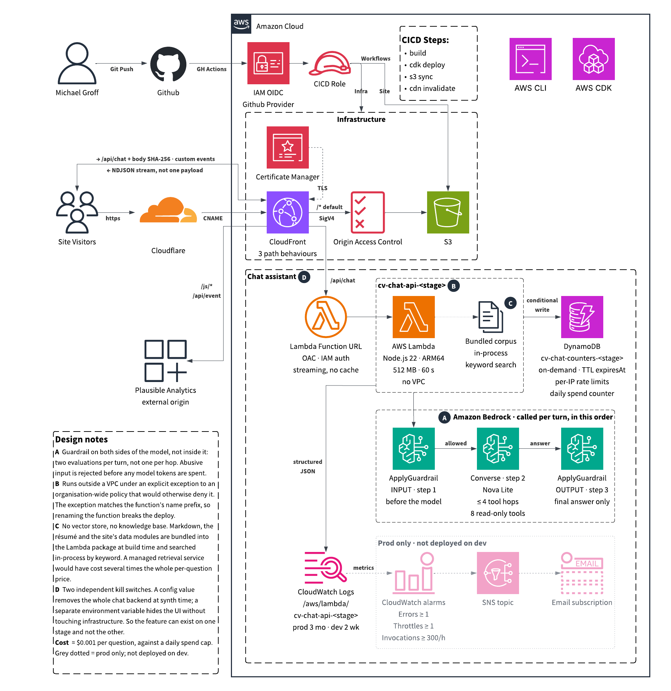

# michaelgroff.info

Personal CV / resume site for **Michael Groff**, AWS Sr. Solutions Architect.
Migrated from a 2015-era WordPress install (The7 theme) to a static
Next.js site on AWS.

Live: **https://michaelgroff.info** (prod) · **https://dev.michaelgroff.info** (dev)

`cv.michaelgroff.info` (the legacy subdomain the site lived on for 10+ years) 301-redirects to the apex via a CloudFlare Redirect Rule, so old links still land on the right place.

Plus two read-only archives parked alongside the site:

- `/legacy/` — 2015-era WordPress CV (The7 theme), static export
- `/blog/` — 2015–2020 WordPress blog (21 posts), mirrored static

## Stack

| Layer | Tool |
|---|---|
| Framework | Next.js 16 (App Router, static export) |
| Language | TypeScript |
| Styling | Tailwind CSS + custom tokens for dark mode |
| Animation | Framer Motion |
| Infrastructure | AWS CDK (TypeScript) |
| Hosting | S3 (private) + CloudFront with OAC |
| TLS | AWS Certificate Manager (DNS-validated) |
| DNS | CloudFlare (not Route 53 — keeps the project single-account) |
| CI/CD | GitHub Actions with OIDC (no long-lived AWS keys) |
| URL rewriting | CloudFront Functions (`/foo/` → `/foo/index.html`) |
| Chat assistant | AWS Lambda (ARM64, Node 22, response streaming) |
| Model | Amazon Nova Lite via Amazon Bedrock `Converse` tool-use loop |
| Safety | Amazon Bedrock Guardrails, applied explicitly on input and output |
| Rate limits + spend cap | DynamoDB, on-demand and TTL'd |
| Retrieval | IDF-weighted keyword search in-process; no vector store, no Knowledge Base |
| Analytics | Plausible (primary, proxied first-party) + CloudFlare Web Analytics as a cross-check. Both cookieless |
| Monitoring | CloudWatch Logs and metrics, with three prod alarms to SNS email |

## Architecture



Highlights and trade-offs are documented on the site itself under **Project →
WordPress → Next.js on AWS**. Short version: zero servers, pennies per month,
`git push` → deploy.

The diagram predates the chat assistant, which adds one path: `/api/chat` on the
same distribution → a Lambda function URL fronted by OAC → Bedrock, with
per-IP and daily spend counters in DynamoDB. There is still no VPC, no
container and no database.

## Repo layout

```
resume.md         # Source-of-truth résumé; regenerated to PDF on each build
knowledge/        # What the chat assistant knows beyond the résumé. Plain
                  # markdown; README.md there is the authority on what may go in
CONTEXT.md        # The repo's vocabulary. Use these names, don't invent synonyms
BACKLOG.md        # Parked work, and decided-against items with the reasoning
LICENSE           # MIT on the code; personal content is all rights reserved
scripts/
  check.sh        # The gate. Lint, both typechecks, tests, synth, artifact
                  # invariants. One command that proves the tree is green
frontend/         # Next.js static site (the CV itself)
  app/            # App Router pages and layout
  components/     # React components (Hero, Experience, Chat, ChatWidget, …)
  lib/data/       # Typed data: jobs, certifications, skills, about, project,
                  # contact, status, chat, testimonials. The page renders these
                  # AND the assistant reads them, so they cannot disagree
  lib/chatPanel.ts        # Open/closed state for the chat widget
  scripts/
    build-resume.mjs      # md-to-pdf → public/resume.pdf; runs as prebuild
    optimize-images.mjs   # raster → WebP; runs as prebuild
  public/         # Static assets (images, favicon, OG, robots, sitemap)
    blog/                 # WordPress blog archive (2015–2020, read-only)
    legacy/               # WordPress CV archive (2015 The7 theme)
infrastructure/   # AWS CDK (TypeScript)
  bin/            # CDK app entry point
  lib/
    cv-website-stack.ts   # S3 + CloudFront + OAC + ACM per stage
    chat-api.ts           # Lambda + DynamoDB + Bedrock guardrail + behaviour
    github-oidc-stack.ts  # One-time OIDC provider + deploy role
  lambda/chat/            # The assistant: agent loop, tools, retrieval, limits
  test/                   # Stack assertions, retrieval and sanitising tests
.github/workflows/
  ci.yml            # pull_request only: build, synth, and the repo gate
  deploy-site.yml   # frontend/** changes → build + sync + invalidate
  deploy-infra.yml  # infrastructure/**, knowledge/**, frontend/lib/data/**,
                    # resume.md → cdk deploy (the Lambda bundles that content)
```

Stage → hostname mapping:

| Stage | Hostname(s) | Bucket |
|---|---|---|
| `dev`  | `dev.michaelgroff.info` | `cv-michaelgroff-dev` |
| `prod` | `michaelgroff.info` (cv.* is a 301 redirect in CloudFlare) | `cv-michaelgroff-prod` |

## Local development

```bash
cd frontend
npm ci
npm run dev      # http://localhost:3000
```

Regenerate the résumé PDF after editing `resume.md`:

```bash
npm run resume   # writes public/resume.pdf from ../resume.md
```

(The `prebuild` hook runs this automatically, so `npm run build` always
ships a fresh PDF. Next dev doesn't auto-resolve directory-index URLs —
append `/index.html` locally, or trust that the CloudFront Function
handles `/foo/` → `/foo/index.html` in prod.)

Production build (matches what ships to S3):

```bash
npm run build
npx serve out
```

## Tests and checks

```bash
./scripts/check.sh            # the gate: everything, offline
./scripts/check.sh fast       # skips the Next build and cdk synth
./scripts/smoke.sh            # prod, against the live deployment
./scripts/smoke.sh https://dev.michaelgroff.info
```

**`check.sh` is the gate** and runs with no AWS credentials: lint, both
typechecks, the test suite, `cdk synth`, and the artifact invariants that have
each regressed at least once. It reports every failure rather than stopping at
the first.

The suite is 200-odd assertions in `infrastructure/test/`, and what it covers
says something about where the bugs have been:

| File | Covers |
|---|---|
| `cv-website-stack.test.ts` | Synthesized template: the OAC origin index, that no `Custom::` resource exists (an LZA SCP denies the Lambda behind one), the alarms |
| `retrieval.test.ts` | Keyword search: broad vs specific, the confident-wrong cases, aliases, morphology, and the content gaps that only a person can fill |
| `limits.test.ts` | The cost arithmetic and IP hashing. Rates verified against a real Cost Explorer bill |
| `tools.test.ts` | All seven tool handlers, hostile and wrong-typed arguments, and that every citation points at a real page anchor |
| `wire.test.ts` | The NDJSON contract between Lambda and browser, and the chunker that strips HTML comments before the model can quote one |
| `sanitize.test.ts` | Stripping model scaffolding: invented tool transcripts and inline source attributions |

**`smoke.sh` tests the deployment rather than the code**, which is a different
class of bug. Every check in it corresponds to something that has broken or
that fails silently: a wrong Plausible filename returns the site's own
`/404.html` with a 200, so the dashboard reads "no traffic yet" and nothing
looks wrong; `CHAT_ENABLED` is environment-scoped, so a green deploy of the
code is no evidence the chat rendered; an OAC signature failure on `/api/chat`
is rewritten to HTML by the same distribution-wide mapping.

It deliberately spends no money: the `/api/chat` check sends a correctly hashed
but invalid body, which exercises the whole signed path and returns a JSON error
without a model call.

## Deploying from scratch

Requires AWS CLI authenticated to the target account (`us-east-1`, CloudFront
requires it for ACM) and CloudFlare access to add DNS records.

```bash
# 1. Bootstrap CDK (once per account/region)
cd infrastructure && npx cdk bootstrap aws://<ACCOUNT_ID>/us-east-1

# 2. Create GitHub OIDC role (once)
npx cdk deploy CvWebsite-OIDC
# → Copy GitHubActionsRoleArn output

# 3. Add AWS_ACCOUNT_ID as a GitHub repo variable. The workflows build the
#    role ARN from it, and pass it as CDK_DEFAULT_ACCOUNT. It is deliberately
#    NOT in cdk.json: an account id is not a credential, but it is the handle
#    that makes the rest of a public repo targetable, and bin/infrastructure.ts
#    throws without one rather than defaulting to someone else's account.

# 4. Deploy the stage (first time is interactive — ACM validation)
npx cdk deploy CvWebsite-dev
#    → While it pauses on Certificate creation, run in another terminal:
#      aws acm describe-certificate --certificate-arn <arn> \
#        --query 'Certificate.DomainValidationOptions[0].ResourceRecord'
#    → Paste that Name/Value into CloudFlare as a CNAME (DNS only, no proxy)

# 5. After stack completes, add CNAME(s) in CloudFlare pointing at the
#    distribution's DomainName output:
#      - dev stack:  dev → <DistributionDomainName>
#      - prod stack: @   → <DistributionDomainName>  (apex; CloudFlare flattens)

# 6. Build and ship the site
cd ../frontend && npm ci && npm run build
aws s3 sync out s3://cv-michaelgroff-dev --delete
aws cloudfront create-invalidation --distribution-id <id> --paths '/*'
```

After the first manual deploy, `git push` to `dev` or `main` fires the
appropriate workflow and handles everything.

## Why CloudFlare and not Route 53

CloudFlare already hosts the apex zone for `michaelgroff.info`. Moving DNS
to Route 53 inside this account would have meant cross-account delegation
for a one-person project. The trade-off is manual CNAMEs for the ACM
validation record and for the distribution alias — worth it for the
single-account simplicity.

## Running costs

The site itself fits well under the AWS Always-Free tier for a personal site
(500 page-views/month kind of traffic): S3 and CloudFront came to about $0.31
and $0.00 in a recent month, with no Route 53 hosted zone because DNS is
CloudFlare.

The chat assistant is measured, not estimated, at **~$0.00096 per turn**
against a `$0.10`/day cap enforced in-request before Bedrock is called, so
~$3.10/month is the ceiling. Guardrails cost roughly twice the model, which is
why they are applied twice per turn rather than on every hop.

Those figures are reconciled rather than estimated: the per-turn cost is
computed in the Lambda from hand-maintained rate constants, and those constants
were checked per SKU against Cost Explorer. The reconciliation found a real
20.9% undercount, because guardrail sensitive-information units bill at a paid
rate that the estimate had omitted entirely.

If you fork this, note that the bill is dominated by whatever governance sits
around the account rather than by the site. In this one, KMS keys created by
Landing Zone Accelerator were about 80% of the monthly total.

## Why this repo is public

The site tells people I do IaC and static-first AWS architecture. Hiding
the CDK code would undercut the message. Everything sensitive is
externalized: AWS identity is OIDC-based (nothing to leak), DNS is managed
in CloudFlare, no API keys in the repo.

That was audited rather than assumed. All 118 commits were scanned for
credential patterns and the AWS account id was pulled out of the tree, since it
is not a credential but it is the one handle that makes the rest targetable.
`BACKLOG.md` records what was checked, what was deliberately kept and why.

The engineering documentation is MIT. The personal content is not: the résumé,
`knowledge/`, the data modules, the images and the WordPress archives describe
one person's career and are published so the site and its assistant can serve
them, not for reuse. See `LICENSE`.

---

Built with [Claude Code](https://claude.com/claude-code).
